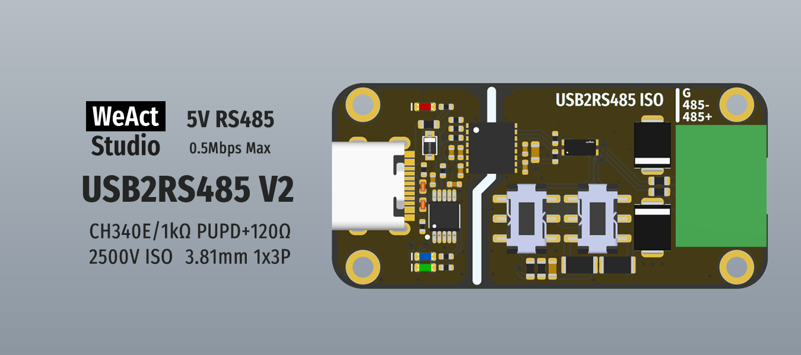

* [English version](./README.md)
# WeActStudio.USB2RS485V2

CH340X
> 全速USB设备接口，兼容 USB 2.0。  
支持通讯波特率 `50bps～2Mbps`。

RS485
> 速率最大2Mbps，5V电平，2500V隔离，可设置1kΩ上下拉以及120Ω终端匹配电阻

连接器  
> 3.81mm 1x3P 15EDGK-3.81-3P

## 驱动安装
见`Drivers`文件夹

```
/*---------------------------------------
- WeAct Studio Official Link
- taobao: weactstudio.taobao.com
- aliexpress: weactstudio.aliexpress.com
- github: github.com/WeActStudio
- gitee: gitee.com/WeActStudio
- blog: blog.weactstudio.com
---------------------------------------*/
```